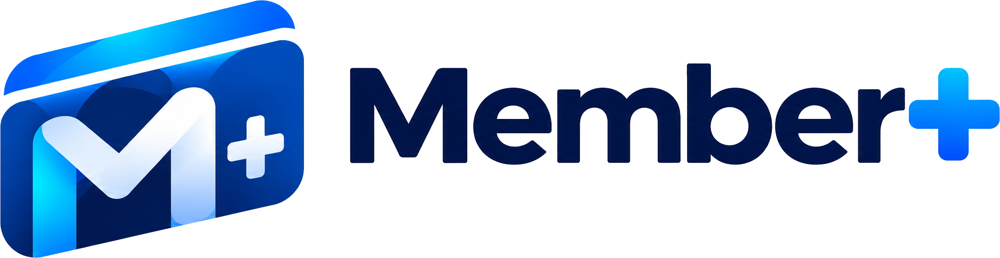

<p align="center">
  <picture>
    <source media="(prefers-color-scheme: dark)" srcset="src/assets/brand/logo-on-dark.png">
    <source media="(prefers-color-scheme: light)" srcset="src/assets/brand/logo-on-light.png">
    
  </picture>
</p>

<h3 align="center">Member+ · Frontend</h3>

<p align="center">
  <em>Cada cliente reconocido, cada cobro rápido.</em><br>
  SaaS multi-negocio de membresías · Universidad Tecnológica de Tijuana · grupo 9C
</p>

<p align="center">
  <a href="https://github.com/AGA-Studio/Member-Plus-Frontend/actions/workflows/ci.yml"></a>
  <a href="docs/DEPLOY.md"></a>
  <a href="docs/CI.md"></a>
  
  <br>
  <a href="https://nextjs.org"></a>
  <a href="https://react.dev"></a>
  <a href="https://www.typescriptlang.org"></a>
  <a href="https://tailwindcss.com"></a>
  <a href="https://nodejs.org"></a>
</p>

---

Member+ es una plataforma donde cada negocio administra sus clientes, tarjetas de membresía por nivel
y compras con descuento, puntos y cashback. El empleado cobra en caja leyendo el **QR impreso** de la
tarjeta con un lector o con la webcam del navegador.

Este repositorio es **solo la interfaz**. Toda la lógica y los datos viven en el API
([Member-Web](https://github.com/AGA-Studio/Member-Web)): Next es un cliente puro, sin rutas API propias.
El navegador pide `/api/*` y Next lo reescribe hacia el API, así la cookie de sesión es de primera parte.

Proyecto académico de la Universidad Tecnológica de Tijuana · *Desarrollo Web Integral* · grupo **9C** · equipo **AGA-Studio**.

## Stack

| Pieza | Versión |
|---|---|
| Next.js (App Router, Turbopack) | 16.4.6 |
| React | 19.3 |
| TypeScript estricto | 5 |
| Tailwind CSS vía `@tailwindcss/turbopack` | 4.3.3 |
| i18n con `next-intl` | 4.14 |
| Node | 22 (`.nvmrc`) |
| Íconos | `lucide-react` |

El diseño no se improvisa: los tokens de color, tipografía, radios y sombras están en
[`BRAND.md`](BRAND.md) y en `src/app/globals.css`.

## Empezar

```bash
cp .env.example .env.local
npm ci
npm run dev
```

Abre <http://localhost:3000>. El API de desarrollo se espera en `http://127.0.0.1:8000`
(`API_INTERNAL_URL` en `.env.local`); sin él la interfaz carga, pero las llamadas a `/api/*` fallan.

## Scripts

| Comando | Qué hace |
|---|---|
| `npm run dev` | Servidor de desarrollo |
| `npm run build` | Build de producción (imagen `standalone`) |
| `npm run lint` | ESLint, incluidas las reglas de convenciones |
| `npm run check:tokens` | Falla con hex sueltos o clases de la paleta por defecto |
| `npm run typecheck` | `next typegen && tsc --noEmit` |
| `npm run messages:check` | Compara las claves de `es.json` y `en.json` |

Los seis corren en el CI en cada PR; `lint`, `typecheck`, `messages` y `build` son obligatorios para mergear.

## Estructura

```
src/app/              rutas, layout raíz y estilos globales
src/assets/brand/     logos e íconos de la marca
src/i18n/             configuración de idioma y resolución por cookie o encabezado
messages/             textos por locale (es.json es la fuente de tipos)
public/               estáticos y healthz.txt
docs/                 CI, despliegue y criterios de revisión
scripts/              chequeos de convenciones y revisor de PRs
```

## Documentación

- [BRAND.md](BRAND.md) — identidad, tokens, componentes y voz.
- [docs/CI.md](docs/CI.md) — qué corre en cada PR y cómo reproducirlo en local.
- [docs/DEPLOY.md](docs/DEPLOY.md) — imagen en GHCR, Coolify, rollback y la trampa del rewrite.
- [PROJECT_MEMORY.md](PROJECT_MEMORY.md) — contexto del proyecto, alcance del MVP y reglas de negocio.
- Diseño en Figma: [Member+ — Diseño](https://www.figma.com/design/OWje3kJvpbLxZlCOEq1WnF).

## Flujo de trabajo

`main` es la única rama: trabajo en `feature/<nombre>`, PR a `main` y merge del equipo. El despliegue es
deliberado — mergear publica una imagen en GHCR, pero producción solo cambia cuando se mueve el tag en
Coolify.

El código va en inglés; todo el texto que ve el usuario pasa por `messages/`. Las reglas para agentes e
integrantes están en [AGENTS.md](AGENTS.md).
